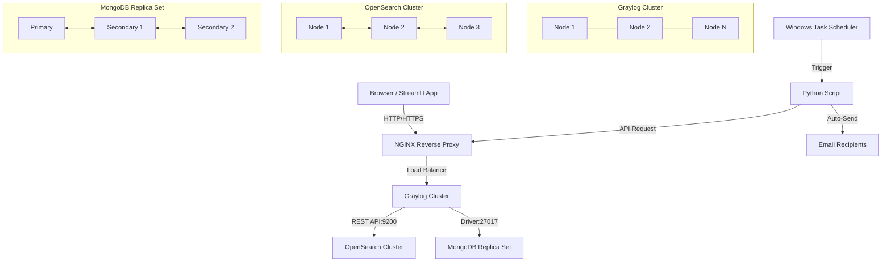

# 日誌分析與自動化報告系統架構說明書

本系統採用高可用性（High Availability, HA）與分散式架構，結合 **NGINX**、**Graylog**、**OpenSearch** 及 **MongoDB**，提供穩定、高效能且具備自動化分析與報表產出能力的日誌管理平台。

---

## 系統架構圖

---

## 目錄
1. [系統層級與架構解析](#-系統層級與架構解析-system-layers--components)
2. [資料流程說明](#-資料流程說明-data-flow--operations)
3. [系統架構達成效益](#-系統架構達成效益-key-benefits)

---

## 壹、 系統層級與架構解析 (System Layers & Components)

本架構由上至下劃分為五大核心層級：

### 1. 使用者介面與自動化來源層 (User Interfaces & Automation Sources)
*   **Browser (Streamlit App)**：提供前端視覺化操作介面，使用者透過 Web 瀏覽器進行日誌查詢、監控與儀表板互動。
*   **Python Script (Analysis/Reporting)**：自動化腳本，用於執行高階日誌分析與定期報表繪製。
*   **Windows Task Scheduler (Daily)**：排程服務，每日定時觸發 Python 腳本執行自動化分析任務。
*   **Email Report Recipients**：自動化報告接收者，Python 腳本分析完畢後自動將結果發送給指定收件人。

### 2. 負載平衡與 API 網關層 (Load Balancing & API Gateway)
*   **NGINX (Reverse Proxy / API Gateway)**：
    *   **統一入口**：作為外部請求（Web UI/API）與日誌數據傳輸（TCP/UDP）的單一存取點。
    *   **流量分發**：將前端請求以負載平衡（Load Balancing）方式均勻分發至後端的 Graylog 集群，提升系統吞吐量並避免單點故障。

### 3. 日誌處理與 API 服務集群層 (Graylog API Services Cluster)
*   **Graylog Nodes (Node 1, Node 2 ... Node N)**：
    *   負責接收由 NGINX 轉發的日誌數據並進行解析、過濾與正規化處理。
    *   提供 RESTful API 供前端與腳本呼叫。
    *   節點間支援 **Inter-node Sync**，確保叢集狀態一致性與高可用性。

### 4. 搜尋與索引集群層 (OpenSearch Index Cluster)
*   **OpenSearch Nodes (Node 1, Node 2, Node 3)**：
    *   **核心功能**：負責儲存海量的日誌資料並提供極速全文檢索與索引服務。
    *   **溝通機制**：Graylog 透過 REST API (`TCP:9200`) 與 OpenSearch 互動；OpenSearch 節點之間透過 `Port 9300` 進行內部資料同步與集群狀態維持（Data Flow）。

### 5. 設定與元資料儲存層 (MongoDB Replica Set)
*   **MongoDB (Primary / Secondary 1 / Secondary 2)**：
    *   **核心功能**：儲存 Graylog 的系統設定檔、使用者權限、報表配置與元資料（Metadata），不直接儲存原始大量日誌。
    *   **高可用機制**：採用 **Replica Set**（主從複製與自動選舉）架構，當 Primary 節點異常時，Secondary 節點能透過投票機制自動升格為新的 Primary，確保服務不中斷。Graylog 透過 Driver (`TCP:27017`) 連接。

---

## 貳、 資料流程說明 (Data Flow & Operations)

1.  **日誌收集與存取流程**：
    *   使用者或服務透過 HTTPS/JSON 或 TCP/UDP 將流量送至 **NGINX**。
    *   NGINX 將請求以負載平衡方式分配至 **Graylog Cluster**。
2.  **資料儲存與索引流程**：
    *   **日誌數據**：Graylog 處理後，透過 REST API (`TCP:9200`) 寫入 **OpenSearch Cluster** 進行索引與儲存。
    *   **系統設定**：Graylog 的配置與元資料透過 Driver (`TCP:27017`) 寫入並同步於 **MongoDB Replica Set**。
3.  **自動化分析與報表產出流程**：
    *   **Windows Task Scheduler** 每日定時觸發 **Python Script**。
    *   Python 腳本發送 API 請求給 **NGINX / Graylog** 獲取所需分析數據。
    *   Python 腳本完成資料分析與圖表繪製後，透過 **Auto-Send** 將分析報告寄送給 **Email Recipients**。

---

## 參、 系統架構達成效益 (Key Benefits)

| 效益維度 | 說明與具體表現 |
| :--- | :--- |
| **高可用性與容錯力 (High Availability & Fault Tolerance)** | 1. **無單點故障**：Graylog、OpenSearch 與 MongoDB 皆採用 Cluster / Replica Set 配置。 2. **故障自動轉移**：MongoDB Replica Set 支援自動選舉（Voting & New Primary），確保設定檔服務持續運作。 |
| **高擴充性與效能 (Scalability & Performance)** | 1. **水平擴充**：Graylog 與 OpenSearch 可隨資料量成長隨時新增節點（Node N），無縫提升運算與儲存能力。 2. **流量分流**：透過 NGINX 進行 Load Balancing，避免單一 Graylog 節點過載。 |
| **運維自動化與效率 (Automation & Operational Efficiency)** | 1. **自動化報表**：利用 Task Scheduler + Python 腳本，實現每日自動分析與 Email 發送，大幅減少人工整理日誌的時間。 2. **靈活的前端展示**：支援 Streamlit 快速構建客製化 Web UI，提升管理人員查詢與決策效率。 |
| **高效搜尋與巨量資料處理 (Fast Search & Analytical Capacity)** | 1. **秒級檢索**：專屬 OpenSearch 分散式集群專門處理日誌索引，能在海量資料中進行精準的全文檢索。 2. **職責分離**：日誌內容（OpenSearch）與系統設定（MongoDB）拆分儲存，優化資料庫讀寫效能。 |

---

## 肆、 總結
本架構通過 NGINX 的負載平衡、Graylog 的集群處理、OpenSearch 的高速索引與 MongoDB 的高可用設定，構建了一個兼顧性能、穩定性與自動化運維的日誌管理系統，能有效解決大規模日誌數據的監控與分析需求。
